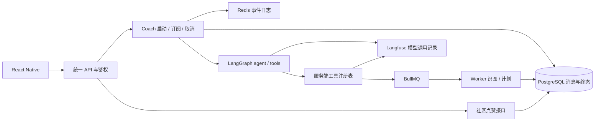

# 项目档案 · Fitness AI Assistant

> 用途：围绕当前简历的 **五点主要实现**，准备前端 / 全栈 / AI 应用面试。
> 核对日期：**2026-10-19（Asia/Shanghai）**；源码基线：`c93b54c`，以当前工作区实现为准。
> 证据口径：源码说明“现在做了什么”，提交差异说明“实现怎样演进”，测试说明“哪些场景已验证”。没有性能测量、线上事故记录的地方，不补写数字或经历。

## 阅读方式

先背每点的“20～30 秒回答”，再按面试官的问题往下展开。五点统一沿用原版点①的结构：**事实卡 → 提问方向地图 → 逐问预答 → 准备动作清单 → 踩坑记录 → 实现细节 → 源码入口**。英文名只在需要对应代码时使用，先用自己的话讲清楚“为什么要做、具体怎么做”。五点顺序与简历截图一致：

1. [AI 对话流式渲染](#point-1)：XHR、序号补播、重连、冷启动、32ms 节流与滚动。
2. [社区点赞并发一致性](#point-2)：意图合并、revision 条件写入、弱网重试与四类缓存。
3. [接口与鉴权](#point-3)：并发 401 单次刷新、Zod、XHR 相册直传。
4. [Coach Agent 工具编排](#point-4)：ReAct 双节点、10 个工具、BullMQ 重任务。
5. [LLM 可观测与稳定性](#point-5)：Langfuse、token 用量、JSON mode 与容错解析。

故事标签：**提交可核实**表示能看到前后改动；**实现型踩坑**表示有源码/注释支撑问题与解法，但没有证据还原某次亲历故障。后者使用“我处理了这个兼容问题”的讲法，不添加“线上用户投诉、排查了几天”等情节。

## 项目描述与当前实现

**简历描述**：AI 驱动的健身助手，覆盖训练打卡、饮食记录、AI 教练对话、体检报告分析与社区动态。个人全栈项目，简历时间为 2026.05 至今。

**面试开场，约 40 秒**：

> 这是我做的一个 AI 健身助手，移动端用 React Native，后端用 NestJS。用户可以记录训练和饮食、上传体检报告，也能让 AI 查健身数据、查天气或者创建计划。我主要准备了五块实现：聊天在弱网下怎么恢复，点赞怎么同步到多个页面，接口和登录状态怎么统一处理，Agent 怎么调工具，以及模型出问题时怎么定位。里面我最想展开的是流式恢复，它涉及从界面到数据库的一整条状态链路。

### 技术栈核对

| 层次     | 当前仓库口径                                                                                                                                                               | 主要证据                                                                                                                                     |
| -------- | -------------------------------------------------------------------------------------------------------------------------------------------------------------------------- | -------------------------------------------------------------------------------------------------------------------------------------------- |
| 移动端   | TypeScript、bare React Native **0.83.9**、React **19.2.0**、React Navigation 7、TanStack Query 5、Zustand 5、NativeWind 4、MMKV、Keychain                                  | [mobile/package.json](../apps/mobile/package.json)                                                                                           |
| 后端     | NestJS **10.x**、Prisma **5.22.x**、PostgreSQL 16、Redis 7、BullMQ、MinIO、Meilisearch；HTTP / Worker / Schedule 三入口                                                    | [api/package.json](../apps/api/package.json)、[db/package.json](../packages/db/package.json)、[Docker Compose](../docker/docker-compose.yml) |
| AI       | LangGraph.js 自定义 ReAct 图、OpenAI-compatible 客户端、Zod、Langfuse OTel / tracing                                                                                       | [ai-core/package.json](../packages/ai-core/package.json)、[模型适配层](../packages/ai-core/src/llm/openai-compatible.ts)                     |
| 模型配置 | 代码默认文本模型标识为 `deepseek-v4-pro`；视觉模型通过 `resolveQwenVlModel` 解析，缺省 `qwen3-vl-plus`。这是**源码默认配置**，不表示本次核验了供应商可用性或部署环境实际值 | [模型常量](../packages/shared/src/constants/ai-task.ts)、[视觉模型配置](../packages/ai-core/src/llm/qwen-vl.ts)                              |
| 工程化   | pnpm workspace、Turborepo、共享 Zod 契约、ESLint / Prettier、Husky / lint-staged / commitlint、GitHub Actions                                                              | [根 package.json](../package.json)、[CI](../.github/workflows/ci.yml)                                                                        |

当前基线有 **54 次提交、28 个 Prisma model、13 个迁移 SQL、13 篇 ADR**。这些是仓库快照计数，不作为用户规模或工程效果指标。删除旧版“约 3 个月 / 47 次提交 / 29.5k 行 / 118 个测试”的过期口径。

### 五点在系统中的位置



普通 Coach CHAT 在 API 进程内异步生成；重任务由 Worker 执行。Redis 保存短期补播事件，PostgreSQL 保存最终消息。不要把全部 AI 请求都描述成走 BullMQ。

## 简历五点与核对结论

以下保留用户简历的五点表述，后文逐项展开；“口径校准”用于回答追问。

| 简历要点                                                                                                                                                         | 核对结论与口径校准                                                                                                                                                                       |
| ---------------------------------------------------------------------------------------------------------------------------------------------------------------- | ---------------------------------------------------------------------------------------------------------------------------------------------------------------------------------------- |
| **① AI 对话流式渲染**：XHR 增量解析 SSE，按序号补播、断线重连与冷启动恢复；配 32ms 节流与帧级滚动跟随                                                            | 已实现。当前为 POST 幂等启动 + GET 订阅 + POST 取消；冷启动恢复指 App 重启后恢复订阅，不能恢复 API 进程崩溃后中断的模型生成                                                              |
| **② 社区点赞并发一致性**：自研 generation 序号协调器丢弃连点产生的 stale 响应，并联动 patch Feed / 详情 / 搜索 / 主页 4 类列表缓存，实现跨页面即时一致的乐观更新 | 原句仅覆盖旧版前端机制。当前已增加意图合并、弱网重试、服务端 revision 条件写入与事务行锁；同一客户端有条件收敛，未提供跨重启恢复或多设备全局点击排序                                     |
| **③ 接口与鉴权**：封装并发 401 单次刷新；共享 Zod 契约校验关键接口响应；相册直传走 XHR，避开 content URI                                                         | 已实现。“关键接口”措辞准确，`apiFetch<T>` 本身只返回类型断言，并非自动校验所有响应                                                                                                       |
| **④ Coach Agent 工具编排**：基于 LangGraph 自定义 ReAct 双节点图接入 10 个工具；识图 / 计划生成等重任务由工具入队 BullMQ，对话侧 SSE 秒级返回而非阻塞等待        | 10 工具及异步拆分已实现。“秒级返回”没有本次延迟实测，准确说法为“对话无需等待重任务完成，任务结果以卡片更新”                                                                              |
| **⑤ LLM 可观测与稳定性**：接入 Langfuse，配合 JSON mode + Zod 校验的容错解析链，可定位工具决策与成本                                                             | 工具决策、调用耗时与 token 用量可记录；成本计算有字段，但当前 DeepSeek / Qwen 客户端单价均配置为 **0**，不能声称已有准确金额核算。多级容错主要用于 JSON Coach 输出，流式正文另走文本链路 |

**建议下次更新简历时调整三处**：② 改为“客户端合并最新意图与弱网重试，服务端版本条件写入，联动四类缓存实现乐观状态同步”；④ 末尾改为“重任务由工具入队 BullMQ，对话无需等待任务完成”；⑤ 末尾改为“可追踪工具决策、调用耗时与 token 用量”。这样仍对应原来的五个亮点，证据更扎实。

## 面试深挖预案

| 简历点           | 主问题                                 | 第一层简洁回答                                                   | 继续深挖准备                                                       | 首选故事                                               |
| ---------------- | -------------------------------------- | ---------------------------------------------------------------- | ------------------------------------------------------------------ | ------------------------------------------------------ |
| ① 流式渲染       | 断网以后为什么不会重复回答？           | 发消息时给一次生成固定编号；断线只接着收，最后拿完整答案核对     | 一次收半条消息怎么办；32ms 和按帧滚动各管什么；重开 App 能恢复什么 | 从“单个 POST 包办生成”改成“启动、订阅、取消分离”       |
| ② 点赞一致性     | 连点、切页面、响应乱序怎么处理？       | 客户端合并最新意图，服务端按版本条件写入，四类缓存同步           | generation 与 revision；同态版本屏障；超时迟到请求；保证边界       | 从旧响应过滤升级为最新意图重试与服务端条件写入         |
| ③ 接口与鉴权     | 多个请求同时 401 怎么办？              | 第一个请求去换新 token，其他请求一起等，换好后各自再试一次       | 等待的 Promise 何时清掉；为什么 TS 之外还要 Zod；相册 URI 怎么上传 | 相册返回 content URI，上传交给 RN 原生 XHR 路径        |
| ④ Agent 工具     | Agent 怎么决定调什么，重任务怎么返回？ | 模型提出要用哪个工具，服务端真正执行；耗时任务先交回任务编号     | 两个节点如何接力；10 个工具做什么；后台完成后怎么让页面看到结果    | 新增记忆工具后，单独限制记忆写入，避免挤占业务工具轮次 |
| ⑤ 可观测与稳定性 | 答得慢、答错、费用高怎么查？           | 把一轮聊天的各次模型调用和工具执行串起来，查哪一步慢、哪一步出错 | 最后一包用量为何会丢；JSON 合法为何还不够；用量怎样换算费用        | 流式最后一包只有 usage 没正文，导致用量没传到上层      |

统一讲述顺序：**用户遇到什么 → 原实现哪里不够 → 我怎样修改 → 用什么验证 → 还有什么限制**。先把因果讲清楚，再补函数名。

<a id="point-1"></a>

## 要点① 深挖手册 · AI 对话流式渲染

> 简历原句：XHR 增量解析 SSE，按序号补播、断线重连与冷启动恢复；配 32ms 节流与帧级滚动跟随。
> 大白话：答案一点点显示；手机断网后能接着收；文字不断变长时，页面还能正常看、正常滑。

### 20～30 秒回答

> 我把开始回答、接收回答、停止回答拆开了。手机用 XHR 收 SSE，事件有编号，断网或重开 App 后能补收，最后用完整答案核对。文字每 32ms 合并更新，滚动按帧安排，拖动时暂停跟随。

### 事实卡（现在做到了什么）

| 环节        | 现在怎样做                                                                                              | 回答时注意                                                                                                         |
| ----------- | ------------------------------------------------------------------------------------------------------- | ------------------------------------------------------------------------------------------------------------------ |
| 启动        | `POST /conversations/:id/messages/stream`，携带 `clientRequestId`；返回 streamId / 两条消息 ID / status | 这个 POST 已经不返回 SSE；`streamId = AiRun.id`                                                                    |
| 幂等与单活  | `clientRequestId` 唯一约束；同一 conversation 的活跃 COACH_CHAT 有数据库部分唯一索引                    | 同一发送的启动重试复用幂等键；不同请求撞上活跃流时 409，客户端转订阅已有流                                         |
| XHR 收包    | `responseText.slice(lastIndex)` 只处理新增字符；buffer 按 `\n\n` 拆事件，留下不完整尾包                 | 这是适配项目自有协议的解析器，不是完整通用 SSE 库；累计 responseText 仍占内存                                      |
| 正文        | 业务 `delta.text` 是**新增片段**，客户端追加；`done/cancelled.finalText` 是最终正文                     | 不再是旧版的“每个 delta 覆盖累计全文”                                                                              |
| 序号        | 文本、工具和终态共用 sequence；客户端跳过 `sequence <= lastProcessedSequence`                           | 当前只过滤重复/旧序号，没有主动发现 sequence gap 并立即补洞；终态快照可以校正正文                                  |
| 补播        | Redis Stream 保存事件；Lua 原子分配序号并 XADD；以 sequence 映射 `<sequence>-0`                         | 当前订阅用 XRANGE + 200ms 间隔检查，并非 ADR 建议的阻塞 XREAD                                                      |
| 保留期      | 活跃事件 TTL 5 分钟，终态后 3 分钟；日志丢失但 DB 已终态时合成终态                                      | DB 仍 RUNNING 且序号 key 丢失时返回 `COACH_STREAM_EXPIRED`，不会自动重启模型                                       |
| 重连        | 0.5 / 1 / 2 / 4 / 8 / 16 秒退避；没有新事件时连续重连最多 6 次，收到新业务事件后重置计数                | 网络错误、5xx 或无终态关闭可重连；4xx 不自动重连；耗尽后可手动重连                                                 |
| 订阅互斥    | 同一活跃流的恢复入口复用一个订阅 Promise 和正文缓冲；替换订阅前先 flush，再失效并 abort 旧订阅          | 对象身份、generation、streamId 校验隔离旧订阅；每次连接的 acceptingEvents 隔离迟到回调；不是 sequence 缺号重排机制 |
| 心跳 / 超时 | 服务端 5 秒注释心跳；客户端每 5 秒检查是否超过 15 秒无字节；Coach 订阅传入 100 秒超时；生成总上限 90 秒 | 15 秒检测有采样间隔；旧“统一 120 秒”仅是通用客户端默认值                                                           |
| 冷启动      | 查会话，找到 RUNNING 助手消息的 aiRunId，从 sequence 0 补播                                             | 未把正文和游标持久化到 MMKV；API 重启后不能续跑原生成，陈旧任务对账为失败                                          |
| 取消        | 显式 POST cancel；AbortSignal 传到模型 fetch；终态通过 `status = RUNNING` 条件更新抢占                  | 切换会话/后台只退订；停止才取消；已经入队的任务或已发生的工具副作用不回滚                                          |
| 展示        | 首段立即 flush，后续新增片段在 32ms 窗口拼接；完成/取消先 flush 再按 finalText 校正                     | 失败会清空临时正文并显示失败态；重连耗尽保留片段                                                                   |
| 滚动        | inverted FlatList；底部 offset 0；120 布局单位近底阈值；120ms 程序滚动标记；rAF 调度去重                | 还有下一帧二次校正，不能说所有 `scrollToOffset` 调用严格每帧一次                                                   |

**两个 32ms 要分开**：移动端是窗口内不重置定时器的节流；服务端当前每次 delta 都重置 32ms 定时器，更接近防抖合并。后者在连续密集 chunk 下可能延迟 flush，不能把 ADR 的“服务端 trailing throttle”当成已经严格实现。

### 提问方向地图

| 方向                | 面试官想知道什么                            | 对应问题 |
| ------------------- | ------------------------------------------- | -------- |
| A. 为什么这样选     | 为什么流式、为什么 XHR、为什么拆接口        | A1～A3   |
| B. 数据怎样收到     | 半包怎么拼、三个编号怎么用、断网怎么接着收  | B1～B4   |
| C. 页面怎样跟得上   | 为什么合并文字更新、32ms 怎么理解、怎样滚动 | C1～C5   |
| D. 出问题怎么办     | App 重开、停止、网络一直恢复不了            | D1～D4   |
| E. 怎么证明、怎么改 | 已有测试、剩余边界                          | E1～E2   |

### 逐问预答

**A1. 为什么要流式，等完整回答出来再显示不行吗？**

> 长答案可能要等一会儿，流式能让用户先看到已经生成的部分，也能中途停止。这里改善的是“等答案时的体验”，没有证据说模型总生成时间变短了。计划、识图这类要拿到完整结构才能用的结果，适合任务卡片。

**A2. 为什么用 XHR，不直接用 fetch、EventSource 或 WebSocket？**

> 这个 RN 工程已经通过 XHR 的 onprogress 拿到逐步到达的内容，鉴权、超时和取消也能统一处理。聊天主要是服务端往手机发内容，SSE 足够。我没有在这里做各个流库的完整对比，因此不会说所有 RN 版本都不能用 fetch stream。现在订阅已经是 GET，也不能再拿“必须 POST”解释选型。

**A3. 为什么拆成启动、订阅、取消三个接口？**

> “让模型开始回答”“把回答发到手机”“让模型停止”是三件事。拆开后，手机掉线只影响接收，重新订阅不会再创建一份回答；用户按停止，才明确通知服务端结束生成。

**B1. 一次 onprogress 就能拿到一条完整事件吗？**

> 不一定，可能半条，也可能几条挤在一起。我先把新增内容放进 buffer，按空行找完整事件，剩下半条留着等下一次。responseText 自己会累计，所以还要记上次读到哪里，避免把旧文字再读一遍。

**B2. clientRequestId、streamId、sequence 分别是什么？**

> clientRequestId 表示“还是刚才那次发送”，防止启动重试生成两份；streamId 表示“我要接哪一次回答”；sequence 表示“这次回答我已经收到第几条事件”。可以记成：发送编号、回答编号、接收进度。

**B3. 断网后怎样补回来，重复的内容怎么办？**

> 服务端把短期事件放在 Redis，客户端重连时带上已经收到的序号，服务端从后面开始发。遇到小于等于已处理序号的事件，客户端跳过。文字、工具状态、结束事件都编号，所以不用拿字数猜进度。

**B4. 有序号了，为什么最后还要发完整正文？**

> 序号负责避免重复处理，最终正文负责确认“最后答案到底是什么”。当前客户端没有专门发现缺号后立即补洞的逻辑；结束时用 finalText 对齐，可以修正显示上的遗漏。它不能把已经漏掉的所有中间工具状态也完整还原。

**B5. 网络不好会导致 sequence 乱序吗？有序号去重就够了吗？**

> 单条连接上，网络慢通常表现为晚到、成批到达或者断开，不是把 SSE 事件随意调换顺序。当前服务端串行发布，Redis 按序号补播，客户端也顺序解析。但前端如果重复建立订阅，两条连接各自有正文缓冲，就可能出现“序号处理有序，文字显示乱序”。所以除了序号去重，还要保证同一条流只由一个活跃订阅和一个缓冲区负责。现在重复恢复会复用订阅，替换前先刷入旧缓冲，再让旧回调失效。这里没有新增按序号排序等待或缺号补洞队列。

**C1. 为什么不每收到一段就更新页面？**

> 更新正文会带来状态更新、组件渲染和 Markdown 处理。如果短时间来很多段，就会反复做这些事。我把邻近片段攒起来一起交给页面，减少更新次数。这个解释是工作量上的分析，实际掉多少帧、快多少还需要测量。

**C2. 32ms 怎么定的，是不是每帧更新？**

> 它是当前选的文字更新间隔，大约一秒三十次，想在及时显示和减少更新之间做折中。第一段直接显示，结束前把剩余文字也交出去。32ms 不是每帧，也不是测出来的最优值；简历里的“帧级”主要说滚动跟随。

**C3. 节流为什么要拼接片段，不能只留最后一份吗？**

> 现在收到的是新增加的字。比如这段时间来了“今天”“练腿”，就要拼成“今天练腿”。只留最后一份会丢掉“今天”。旧协议传的是累计全文，那个时候留最新全文才成立。

**C4. rAF 到底帮了什么，为什么节流后还需要它？**

> 32ms 管“什么时候更新正文”；rAF 管“什么时候发滚动指令”。一次文字更新可能触发多个布局回调，scheduleFollow 用 ref 记录已经排了一次滚动，其他回调就不再排。去重是这段代码做的，rAF 本身不会自动合并所有回调。

**C5. 用户正在往上翻，新内容会不会把他拽回去？**

> 拖拽开始时暂停跟随，回到靠近底部的位置再恢复。程序自己的滚动也会触发 onScroll，所以用一个短暂标记防止误认成用户操作。当前流结束时会重新开启跟随，所以还不能说任何时候都不会打断历史阅读。

**D1. App 被关掉再打开，还能恢复吗？**

> 可以先从服务端查会话，找到还在 RUNNING 的助手消息和 aiRunId，再从序号 0 订阅。这里没有把正文和游标存在手机 MMKV 里，恢复靠服务端消息和短期事件日志。

**D2. 那服务端重启呢，Redis 日志过期呢？**

> 模型生成现在跑在 API 进程里，进程退出就不能从原位置接着生成。Redis 日志没了但数据库已有最终结果，可以补发最终结果；数据库仍是运行中而日志也没了，则返回过期错误。超时未完成的任务另有对账处理。

**D3. 按停止和退出聊天页面有什么区别？**

> 退出页面或进入后台主要是退订，服务端可以继续生成。按停止会调用 cancel，服务端向模型请求传取消信号，并保留已生成的部分。已经执行的工具操作、已经放进队列的计划任务不会随之撤销。

**D4. 一直断线会无限重连吗？失败后重新发送算重连吗？**

> 没有新事件时，按 0.5、1、2、4、8、16 秒间隔尝试，耗尽后让用户手动重连。重连还是接原回答；失败后的“重新发送”会创建新任务。两者不能混在一起，否则容易重复生成。

**E1. 你用什么证明恢复逻辑有效？**

> 现有移动端 16 个测试覆盖断线、重复事件、退避、手动重连、取消竞态和最终正文校正，也覆盖重复恢复共用订阅、断开先刷缓冲、旧回调与旧清理隔离。订阅修复后的这组测试全部通过，部分用例在最终快照到达前就断言正文顺序，避免被 finalText 校正掩盖问题。模拟测试证明这些状态分支按预期处理，真实手机上的网络分块、后台行为还要单独验证。

**E2. 如果再改一轮，你先改什么？**

> 我会先补关键链路的真实网络验证，再处理服务端 32ms 定时器被不断重置的问题，以及取消依赖进程内状态的问题。如果要多实例部署，生成任务归谁执行、取消发给哪个实例，需要设计清楚。这些是后续改进。

### 准备动作清单

1. 能画出“POST 启动 → GET 接收 → 断网重订阅 / POST 停止”的流程，并解释三个编号。
2. 用“前一包收到半个 JSON”“同一个序号收到两遍”“序号已处理但正文还在缓冲里”各举一个例子；区分网络传输顺序和 UI 缓冲刷新顺序。
3. 看懂节流器的 `push / flush / dispose`，再看滚动的 `scheduleFollow / scrollToBottom / followNow`。
4. 演示前准备断网、重开 App、停止、失败后重发四个场景；把未实测场景标清楚。
5. 若补性能数据，固定设备、回答长度和测量方法，记录正文更新次数及耗时；不要把 32ms 参数直接当作性能收益。

### 踩坑记录（问题 → 原因 → 修改 → 验证）

#### 问题 1：断线恢复为什么必须改变协议（提交可核实）

**旧实现与问题**：一个 POST 同时负责创建消息、跑模型和推 SSE。断网后，重新 POST 可能再次创建消息；只断开 XHR 又无法表达用户是否想停止。旧版 delta 发送累计全文，长回答不断重复传输前面的文字。

**定位与取舍**：缺的是“这一次生成”的稳定身份，以及“我已经收到哪里”的位置。单纯在客户端加 retry 无法补齐这些信息。

**修改**：用 clientRequestId 标识同一次启动，用 streamId 标识生成，用 sequence 标识进度；GET 可重复订阅。模型生成与连接解绑，真正停止走 cancel。最终正文负责把界面收敛到持久化结果。

**验证**：移动端现有测试覆盖断线补播、重复事件、6 次退避、手动重连、取消期间断线、最终快照校正及失败清空。服务端幂等并发、数据库终态竞态没有同等级的已运行集成测试证据。

**45～60 秒话术**：

> 早期一个 POST 从创建消息一直管到生成结束。准备支持断网恢复时，问题就出来了：重新发 POST 可能重复生成，只断开连接又不代表用户想停止。所以我先拆开生命周期，给一次生成一个固定 ID，再给事件编号。断线以后只补订阅，服务端继续原来的任务；重复事件跳过，最后用完整正文校正。这个方案解决的是手机掉线和重开 App，服务端进程重启后继续生成还没有做。

**提交**：`537e66b` 记录协议决策；`40be447` 落地恢复协议；`c93b54c` 增加失败消息原地重发。失败后“重新发送”会启动新一次任务，与原流补播不同。

#### 问题 2：节流改成真增量后，不能只留最后一段（提交可核实）

`8789a6b` 把每个 delta 直接 `setAssistantContent` 改为节流。旧协议每段是累计全文，窗口内保留最后一份即可；`40be447` 改为真增量后，节流器必须把窗口内片段拼接，否则丢字。

> 节流器不是只加一个定时器。以前收到的是全文，我可以只保留最新值；后来协议改成新增片段，就必须把窗口内所有片段拼起来。结束时还要 flush，避免最后几个字留在定时器里。这是协议语义改变后，UI 层也必须一起改的地方。

不要把“32ms 内容批量刷新”说成“所有 React 状态每秒最多更新 31 次”：sequence、工具状态等仍可能单独更新；也没有帧率提升的实测结果。

#### 问题 3：自动滚动和手指拖动互相打架（实现型踩坑）

**问题与原因**：文字变长会请求滚动，用户拖拽也会触发滚动事件；程序滚动同样会触发 onScroll。如果不区分来源，可能把程序自己的动作当作用户离开底部。

**当前处理**：拖拽时关掉跟随；靠近底部时恢复；程序滚动设置 120ms 标记；多个布局回调通过 ref 只排一次跟随任务。inverted 列表的底部就是 offset 0，省去反复计算内容高度。

**可直接讲**：

> 难点是同一个滚动回调既可能来自用户，也可能来自代码。我先区分这两种情况，再决定要不要跟随。这样用户拖动时能优先看历史，正常接收回答时又能跟上新内容。

**验证边界**：代码机制已核对，本次没有真机手势测试；流结束会恢复跟随，需要作为一个单独场景验收。

#### 问题 4：长文字和 Markdown 表格撑出气泡（实现型踩坑）

**问题与处理**：气泡要允许收缩并限定宽度，内容区域也要拿到可用宽度。当前使用 `max-w-[85%] / min-w-0 / shrink / overflow-hidden` 等约束；表格重写 table、tr、th、td 渲染，用 RN 的 View 和 Text 排列，两个列时按 0.28 / 0.72 分配空间。

**可直接讲**：

> 我从气泡容器和表格单元格两层限制宽度，让长内容有空间换行。表格则自己控制每行、每列的布局，避免训练计划一显示成表格就把聊天气泡撑开。

**验证边界**：这是从实现能确认的处理方案，不能直接套用 Web 的 `min-width: auto` 当作 RN 的已证实根因。演示应包含长链接、中文长段落、两列表格和更多列的表格。

#### 问题 5：序号去重正确，重复订阅仍可能把正文拼错（已修复，有回归测试）

**问题与原因**：恢复入口原先可能重复建立订阅，各自创建 32ms 节流器，但共用 Zustand 中的接收游标。例如 A 接受序号 11，游标已经推进，文字仍在 A 的缓冲里；B 从 11 后订阅，收到 12 后首段立即刷新；A 随后才刷出 11，界面就成了“12 的文字 + 11 的文字”。这不需要单条网络连接发生乱序，单靠 `sequence <= lastProcessedSequence` 去重也挡不住。最终快照可能修正正文，因此只检查结束后的答案会漏掉这个问题。

**修改**：

1. `subscribeCoachStream` 统一持有 `activeSubscription`。同一会话、同一活跃流的重复重连和恢复复用同一个 Promise、AbortController 与正文节流器；自动重试也沿用这份缓冲，不另起并行重试链。
2. `unsubscribeCoachChatStream` 在旧订阅仍拥有当前流时同步 `flush`，先把已接受的片段写进正文，再销毁缓冲、清除订阅身份、递增 generation 并 abort。这样新订阅按共享游标续接时，前面的正文不会还留在旧定时器里；若已切到其他流，则丢弃旧缓冲，不能刷进新回答。
3. 事件回调和缓冲刷新都校验订阅对象身份、generation 与 streamId；每次连接另有 `acceptingEvents`，即使是同一订阅自动重试，上一条连接的迟到事件也会被忽略。旧订阅的清理只能清自己的资源，不能清掉新订阅。
4. `apiStreamSSE` 接收订阅的 AbortSignal，在创建 XHR 前检查是否已取消，避免鉴权刷新结束后重新开启已失效的连接。

**验证**：新增 6 个回归用例，分别覆盖重复恢复共用连接和缓冲、断开 flush 与旧回调/清理隔离、切流隔离、退避期间重复恢复及旧重试失效、上一连接的迟到事件、启动后立即退订不建连接。流式测试共 16 个通过；类型检查、ESLint 和 diff 检查通过。尚未进行真机弱网验收，也不能据此声称具备任意缺号自动补洞能力。

**45～60 秒话术**：

> 我排查过一个不太直观的问题：有序号去重，不代表页面里的文字一定按顺序出现。旧实现可能重复订阅同一条流，两条连接各自有 32ms 缓冲。第一条连接虽然已经接受了前一段、推进了游标，但文字还没显示；第二条连接接着收到后一段，首段立即显示，就会把顺序反过来。我把订阅入口收敛成一个管理对象，同一条流的恢复共用连接和缓冲；必须替换时，先刷出旧缓冲，再让旧回调和定时器失效。测试也特意在最终快照到达前检查正文，避免最终校正把中间的错误掩盖掉。

### 实现细节：一次新文字怎样走到页面底部

```text
XHR 收到新增字符 → 拼出完整 SSE 事件 → 校验当前订阅及本次连接仍有效
  → 检查 sequence → 新文字进该订阅共用的 32ms 缓冲区
  → 刷新前再次校验订阅 → appendAssistantDelta 更新正文
  → 气泡变高，内容尺寸 / 布局回调触发
  → scheduleFollow：允许跟随，并且没有排队中的跟随任务？
  → rAF 回调清掉排队标记 → scrollToBottom(offset=0)
  → 下一帧再校正位置；120ms 标记减少程序滚动对跟随状态的干扰
```

| 函数或状态       | 大白话解释                           | 容易被追问的细节                                              |
| ---------------- | ------------------------------------ | ------------------------------------------------------------- |
| `scheduleFollow` | “已经预约一次滚动，其他人不用再预约” | 去重靠 followRafRef；回调开始时清空它                         |
| `scrollToBottom` | “现在贴到底，下一帧再对一下位置”     | 所以全部滚动调用不是严格每帧一次                              |
| `followNow`      | “不等预约，立即滚动”                 | 取消已排的 rAF 时，同时清空 ref，否则以后可能一直以为已经排队 |
| 几个 `ref`       | 保存回调要读的当前标记               | 改标记本身不用让页面重新渲染；避免回调一直读旧状态            |
| `memo`           | 参数没变时争取少重渲染               | 不能承诺所有历史消息绝不重渲染                                |
| 清理             | 页面卸载时取消跟随任务和标记定时器   | 校正 rAF、320ms 收尾定时器未全部保存句柄取消，仍可完善        |

### 容易混淆的边界

| 继续追问                        | 可以补充的细节                                                                         |
| ------------------------------- | -------------------------------------------------------------------------------------- |
| 停止后那半段会进入历史吗？      | 已确认片段会保留，后续历史注明它被中断；失败提示不当作回答正文                         |
| 取消和完成同时发生怎么办？      | 两条路径都要求数据库当前仍为 RUNNING，条件更新成功的一方决定终态                       |
| Redis 会无限存事件吗？          | 有 TTL；日志长度到 1999 后不再发布 delta，但工具和终态仍可写，所以不是严格最多 2000 条 |
| 多个 API 实例之间能直接接力吗？ | 日志共享，但 AbortController 和部分正文仍在单个进程里，跨实例取消和生成接管还没做完整  |

### 源码与演示入口

- 传输与恢复：[client.ts](../apps/mobile/src/api/client.ts)、[coach.ts](../apps/mobile/src/api/endpoints/coach.ts)、[stream store](../apps/mobile/src/features/coach/coach-stream-store.ts)、[CoachScreen](../apps/mobile/src/features/coach/CoachScreen.tsx)。
- 渲染：[节流器](../apps/mobile/src/features/coach/coach-stream-delta-throttle.ts)、[ChatMessageList](../apps/mobile/src/features/coach/components/ChatMessageList.tsx)、[CoachMessageBody](../apps/mobile/src/features/coach/components/CoachMessageBody.tsx)。
- 服务端：[conversations.service.ts](../apps/api/src/modules/conversations/conversations.service.ts)、[Redis registry](../apps/api/src/modules/conversations/coach-stream-registry.service.ts)、[唯一索引迁移](../packages/db/prisma/migrations/20260930120000_coach_resumable_stream/migration.sql)、[历史上下文](../apps/api/src/domain/coach-chat-history.service.ts)。
- 验证：[16 个恢复与订阅隔离用例](../apps/mobile/src/api/endpoints/coach-stream.test.ts)、[弱网手测清单](./testing/coach-stream-weak-network.md)。清单中的故障注入接线在当前 service 中已注释，**只设置环境变量不会启用**；本次没有执行真机弱网验收。

<a id="point-2"></a>

## 要点② 深挖手册 · 社区点赞并发一致性

> 简历原句（旧实现）：自研 generation 序号协调器丢弃连点产生的 stale 响应，并联动 patch Feed / 详情 / 搜索 / 主页 4 类列表缓存，实现跨页面即时一致的乐观更新。
>
> 当前建议表述：设计按目标共享的 generation 协调器，合并连点意图并实现弱网退避重试；服务端通过 revision 条件写入与事务行锁防止旧请求覆盖新状态，联动 Feed、详情、搜索和用户主页缓存，实现跨页面乐观状态同步。
>
> 简历精简版：通过客户端意图合并与弱网重试、服务端版本条件写入保障最新意图收敛，联动四类页面缓存实现乐观更新，防止乱序请求覆盖已确认状态。
>
> 大白话：用户可以一直点，页面立即响应；后台只追着最新目标同步。服务器也检查版本，迟到的旧请求不能覆盖已经确认的新状态。

本节点赞代码按 **`464c611`（fix: 弱网情况下点赞/取消的最终一致性）** 核对。该提交更新了客户端协调器、API 条件写入、共享协议和数据库迁移；这里的代码基线与文档其他章节保留的历史核验基线分别记录，提交了迁移文件不代表已经对运行中的数据库执行迁移。

### 原简历与当前实现对照

| 原句中的说法               | 现在是否仍准确               | 面试时怎样解释                                                                   |
| -------------------------- | ---------------------------- | -------------------------------------------------------------------------------- |
| 自研 generation 序号协调器 | 仍有这层机制，但职责扩展了   | 现在协调器按目标共享最新意图和同步循环，不再每次点击都独立发请求                 |
| 丢弃连点产生的 stale 响应  | 仍成立，但不足以概括整体方案 | 旧响应不更新界面；已经发生的服务端写入不能靠丢弃响应撤销，需要 revision 条件写入 |
| 联动 patch 四类列表缓存    | 缓存联动仍保留，措辞应修正   | 是四类页面缓存：Feed、详情、搜索、用户主页；详情是单对象，不是列表               |
| 跨页面即时一致             | 容易被理解成过强保证         | 同一客户端的已有缓存做乐观同步，服务器在明确前提下最终收敛，不是多设备实时强一致 |
| 社区点赞并发一致性         | 当前比旧实现更能支撑这个标题 | 分开讲前端意图合并、服务端条件提交和弱网重试，不能只讲 generation                |

**一句话解释升级点**：以前主要防止“旧响应把界面改回去”，现在还防止“旧请求把数据库改回去”，并让最后一次未成功的操作继续同步。

### 20～30 秒回答

> 我把点赞分成界面响应和后台同步两部分。同一帖子在四类缓存里一起更新，连续点击先合并成最新目标，由一个共享循环同步。服务端通过版本条件写入，在事务里更新点赞关系和计数；旧版本请求会被拒绝，网络失败则重试最新目标。这样应用持续运行、网络恢复且操作获准后，能收敛到最后一次点击。

### 事实卡（现在做到了什么）

| 环节       | 当前实现                                                                                            | 为什么需要                                                 |
| ---------- | --------------------------------------------------------------------------------------------------- | ---------------------------------------------------------- |
| 本地意图   | 协调器按目标维护 generation、likedByMe 和回调；`toggle` 优先基于待同步意图取反                      | 同一目标的多个组件共享意图，避免连点读取尚未重渲染的 props |
| 合并同步   | 每个目标一个 `drain` 循环，新点击替换目标，不逐次创建独立 mutation                                  | 中间点击可以合并；旧请求完成后继续提交最新目标             |
| 两种序号   | generation 只在客户端比较意图；revision 持久化到数据库，写请求携带 expectedRevision                 | 本地响应过滤与服务器写入保护是两个问题                     |
| 请求协议   | GET `/like` 读版本；PUT 表示赞，DELETE 表示取消，body 必须带 expectedRevision                       | 请求表达目标状态，并约束它可以基于哪个版本提交             |
| 条件写入   | `(userId, targetKey)` 版本行；事务内初始化、`SELECT FOR UPDATE`、比较版本、维护关系和计数、推进版本 | 相同版本的竞争请求只能有一个成功提交                       |
| 取消屏障   | 取消后保留版本行；目标状态未变化的成功写入也推进版本                                                | 即使本来就没赞，也要挡住仍在网络里的旧点赞                 |
| 冲突反馈   | 返回 `applied: false` 和当前 revision / likedByMe / likeCount，不修改业务状态                       | 客户端用新版本提交此刻的最新目标，而不是盲目重发旧意图     |
| 弱网重试   | 单次等待上限 15 秒；网络错误、408、429、5xx 按 1/2/4/8/15 秒退避重试                                | 超时不代表服务器停止，必须继续靠版本保护与同步循环收敛     |
| 四类缓存   | Feed、详情、帖子搜索、用户主页帖子；评论更新对应评论列表                                            | 同步已有的同一客户端缓存，详情是单对象而非列表             |
| 乐观显示   | patch 前比较目标，计数只按状态差加减；按钮通过 `useSyncExternalStore` 优先展示待同步目标            | 后台读取期间仍显示最新意图；pending 只调透明度，不禁用点击 |
| 确认与失败 | 最新写入确认后取消相关旧查询并应用响应；明确的非重试错误提示并刷新                                  | 已移除旧的无保护 onSettled 回查和整页快照回滚              |
| 生命周期   | 退出账号清空内存循环；待同步意图尚未持久化                                                          | 不承诺杀进程后的恢复，也不承诺多设备全局点击顺序           |

### 提问方向地图

| 方向              | 面试官想知道什么                                     | 对应问题 |
| ----------------- | ---------------------------------------------------- | -------- |
| A. 为什么需要协调 | 单个按钮为什么不够、React Query 与业务协调器怎样分工 | A1～A2   |
| B. 连点与乱序     | generation / revision 区别、合并循环、共享 pending   | B1～B4   |
| C. 四处缓存       | 哪四处、怎样改、旧查询如何处理                       | C1～C3   |
| D. 失败与服务端   | 重试、条件写入、计数与保证边界                       | D1～D4   |
| E. 验证与改进     | 故障用例、实测边界、跨重启与多设备                   | E1～E2   |

### 逐问预答

**A1. 点赞不就是把一个布尔值取反，为什么做协调器？**

> 同一帖子出现在多个页面，用户还能连续点击。按钮各自发请求会出现局部状态不一致、旧响应覆盖新操作，甚至服务器按错误顺序落库。现在同一目标共享最新意图和同步循环，页面负责立即展示，循环负责让服务器逐步追上最新目标。

**A2. React Query 自带乐观更新，为什么还要自己写？**

> React Query 管查询缓存，但不会替业务定义“哪个点击最新、哪些中间点击可以合并、发生版本冲突该重试哪个目标”。协调器补这层同步规则，缓存仍交给 React Query。当前点赞不再用每次点击一个 useMutation 的方式；其他业务仍可用 mutation。

**B1. generation 和 revision 有什么区别？**

> generation 是一个待同步循环里的本地意图序号，点击时递增，只用来判断请求是否仍代表最新意图；循环结束后记录会移除，下次可以重新从 1 开始。revision 是数据库持久化版本，只有服务端接受写入才递增。客户端先 GET 得到 revision，再作为 expectedRevision 提交。没有把本地 generation 直接传给数据库，也没有用手机时间戳判断新旧。

**B2. 它和聊天的 sequence 是一回事吗？**

> 不是。聊天 sequence 标记服务端事件进度，用于断线补播；点赞 generation 区分本地操作，revision 限制数据库写入。三者各管一个范围，不能因为都是递增数字就混用，也不是同一个全局请求 ID。

**B3. 现在还用 inFlight 计数吗？为什么不把每次点击排队发送？**

> 旧实现多个 mutation 并发，所以用计数判断是否仍有请求。现在已移除 inFlight，是否还有待同步意图就是 pending，每个目标只有一个同步循环。比如一个点赞正在提交，用户又取消、点赞、取消，循环只需继续提交最终的取消。不能说物理上永远只有一个 HTTP 请求：超时结束了本地等待，旧请求仍可能在服务器执行，最终安全性靠服务端版本检查。

**B4. useSyncExternalStore 有什么用，按钮会禁用吗？**

> 它让不同页面订阅协调器中的同一目标。同步期间，按钮优先显示这份目标，而不是被后台查询更新过的旧 props；计数按目标与缓存状态的差值展示。按钮变淡但仍可点击，新点击进入同一个循环。pending 表示尚未确认，不是服务端锁。

**C1. 四类缓存具体是哪四类？**

> 动态流、帖子详情、帖子搜索结果、用户主页帖子列表。详情是一条对象，其余主要是分页列表。`patchPostInAllLists` 按 postId 更新各处已有副本，搜索结果还需要进入 posts.items。评论用对应帖子的评论列表缓存。

**C2. 为什么点赞数不会被四处 patch 加四次？**

> 四处各自更新自己的副本，不是对同一个数据库计数加四次。patch 先检查 likedByMe 是否已经等于目标，相同就不加减，不同才加一或减一，最低为零。最终计数用服务端确认值更新；这不是对其他用户同时点赞的实时推送。

**C3. 直接 invalidate 然后重新请求不行吗？**

> 仅刷新会让用户等待网络，刷新还可能和后续点击竞争。现在点击先 patch 四类缓存，提交成功后直接应用服务端确认结果；乐观更新和确认时都会取消 Feed、详情、帖子搜索和用户主页的相关旧查询。旧的 onSettled 无保护回查已移除。明确失败才提示并刷新，同步期间按钮优先显示本地目标。

**D1. 请求失败了为什么不恢复之前保存的快照？**

> 整页旧快照可能把后续点击一起撤销。现在网络错误会保留最新意图并退避重试；旧请求失败时如果已有更新点击，就继续处理最新目标。明确的权限拒绝、内容不存在等错误停止重试、提示并刷新。不能说所有失败都会无限重试，更不能把进程内重试说成离线持久化。

**D2. 为什么用 PUT / DELETE，还要带 expectedRevision？**

> 目标态操作避免重试 toggle 导致反复翻转，但单有目标态不能防止旧 PUT 在新 DELETE 后执行。expectedRevision 补上条件写入：服务器当前版本不匹配就返回 applied=false 和当前状态，客户端再用新版本提交最新目标。同一请求重复到达不会重复计数，也不会再次推进版本；同态的新版本写入则会推进版本。

**D3. 数据库怎样保证版本、点赞关系和计数一致？**

> 同一用户和目标共用版本行，事务内先初始化，再 SELECT FOR UPDATE 加行锁，匹配版本后才写关系。点赞用 createMany 加 skipDuplicates，实际新增才增加计数；取消按 deleteMany 的实际删除数量减计数。版本递增也在同一事务里，失败一起回滚。当前已替代旧的 create/P2002 分支，不能再把旧分支当作现行实现。

**D4. 这样就保证服务器最后一定是用户最后一次点击吗？**

> 有前提：同一持续运行的客户端停止点击，网络最终恢复且操作获准后，同步循环会收敛到最新意图；迟到的旧版本请求不能覆盖已经确认的新状态。例如旧点赞带版本 0，最新取消先提交把版本推进到 1，旧点赞到达就被拒绝。反过来旧点赞先提交，最新取消会遇版本冲突，再用新版本提交。取消时即使本来就没赞也要推进版本，否则挡不住迟到旧请求。永久断网、权限拒绝、杀进程和多设备全局排序不在这个保证内。

**E1. 怎样测试，比自己快速点几下更可靠？**

> 用可控 Promise 和假计时器固定顺序，覆盖读取版本前连点、跨组件合并、写入成功但响应丢失、旧请求超时后迟到、最后一次失败与冲突重试、明确拒绝和退出清理。API 分别验证帖子与评论的版本冲突、同态版本屏障、重复请求与事务失败。2026-10-19 这次改造通过了移动端 6 项和社区 API 44 项相关回归，共 50 项；不是新增了 50 项。API 测试使用内存事务替代数据库 IO，尚不能证明真实 PostgreSQL 的并发锁行为。

**E2. 下一步优先补什么？**

> 先在测试库验证真实行锁与并发事务，再做真机弱网和跨页演示；如果要求杀进程后仍恢复，就增加按账号隔离的持久化 outbox。若扩展到多设备，需要先定义冲突语义，不能直接比较设备时间戳说谁最后点。上线前还要执行版本表迁移并同步更新前后端，旧客户端缺少 expectedRevision 会被拒绝，不能保留绕过版本校验的旧入口。

### 准备动作清单

1. 画出“两种序号”：generation 管客户端意图，revision 管数据库条件提交；指出本地序号不是全局版本。
2. 分别画“最新取消先执行”和“旧点赞先执行”的时序，解释拒绝旧版本与冲突重试。
3. 解释为什么取消后保留版本、同态也递增，以及为什么 GET 看到目标状态仍不代表同步完成。
4. 打开 `patchPostInAllLists`，指出四类缓存、详情单对象、搜索嵌套分页和相关查询取消。
5. 展示协调器的延迟请求测试，明确超时并不等于服务器取消了操作；不把 mock 测试说成真机或生产压测。
6. 讲清代码、部署和保证范围：版本表迁移尚未在本次执行，意图尚未跨重启持久化，多设备不提供全局点击时间排序。

### 踩坑记录（问题 → 原因 → 修改 → 验证）

#### 问题 1：回滚旧快照可能覆盖后来的点击（历史提交可核实）

**旧实现**：`6a24fc9^` 已经有四类缓存联动，并保存 Feed / 详情 / 搜索 / 主页快照，失败时整份恢复；按钮依赖自己的 mutation pending 禁用点击。

**历史修改**：`6a24fc9` 删除快照回滚，增加共享 generation / inFlight，只接纳最新响应，再拉服务端状态；继续复用原有四类缓存统一 patch。四类缓存联动不是这次提交才新增的。

**当前定位**：这是从快照回滚到客户端响应过滤的第一阶段，不能把该提交说成已经实现服务端条件写入。2026-10-19 的后续提交 `464c611` 进一步移除了 inFlight 和 onSettled 回查，采用意图合并、条件写入与重试。

#### 问题 2：旧响应被忽略了，数据库仍可能保存成旧意图（提交 `464c611` 与测试可核实）

**问题机制**：旧点赞 PUT 在网络里滞留，最新取消 DELETE 先执行，旧 PUT 后执行。前端拒绝旧响应不等于撤销服务器写入；单纯幂等也无法规定两个相反操作的顺序。

**修改**：客户端每个目标一个循环，只追踪最新意图；服务端新增持久化 revision，以行锁和版本条件检查保护关系、计数和版本的原子提交。保留取消状态的版本记录，同态写入也推进版本。迟到请求版本过期即拒绝，最新意图冲突后再提交。

**45～60 秒话术**：

> 最初我用 generation 丢弃旧响应，解决了界面回退，但后来检查弱网时序发现，服务端还是可能先取消、后执行旧点赞。于是我把界面意图和数据库版本分开：前端合并连续点击、重试最新目标，后端在事务里校验版本并更新关系和计数。一个容易漏的细节是取消时即使没有点赞记录，也要推进并保留版本，否则迟到的旧点赞还能生效。我用可控延迟测试了响应丢失、超时和乱序，但真实 PostgreSQL 并发与真机弱网还需要验收。

**验证**：移动端协调器 6 项、API 条件写入 9 项专项用例通过；后者包含在社区 API 44 项回归中，不重复相加。没有据此声称线上事故排查经历或性能收益。

#### 问题 3：动态流变了，搜索页还是旧的（实现型踩坑）

**原因**：帖子在不同 queryKey 下各有缓存；搜索结果还多包一层 posts.items，改动态流不会自动改搜索。

**当前处理**：统一 patch 四类缓存，乐观更新与确认时取消对应旧查询；按钮同步期间优先显示协调器中的目标。最终接纳最新意图成功写入后的响应，不再追加无保护的校准 GET。

**可直接讲**：

> 跨页面同步的难点是同一业务数据有多个缓存副本。我把更新入口收在一起，再协调旧查询和待同步目标。这里保证的是同一客户端的乐观显示与确认后同步，不是多个设备实时强一致。

### 实现细节：一次点击的完整时序

```text
点击 → 从待同步目标或当前显示计算下一目标
  → 创建意图，或更新同一意图并递增 generation
  → 立即 patch 缓存；通知各页面按钮
  → 同一目标的 drain 循环：
      没有可用版本 → GET /like
      读取此刻最新意图 → PUT / DELETE + expectedRevision
      服务端事务：初始化版本行 → 行锁 → 比较版本
        匹配：增删关系、维护计数、版本 +1（同态也 +1）
        不匹配：不写入，返回当前状态与 applied=false
      请求期间又点击了 → 不刷新旧响应，继续提交最新意图
      版本冲突 → 用返回版本继续提交最新意图
      最新意图提交成功 → 取消相关旧查询、应用确认状态、结束 pending
      网络错误或超时 → 重新读状态并重试最新意图
      明确拒绝 → 停止、提示并刷新
```

**为什么 GET 看到目标态还不能直接结束？** 旧写请求可能尚未到达，读取只说明“此刻相同”。最新意图必须成功执行一次条件写入、推进版本，才能阻止仍携带旧版本的请求生效。超时只结束本地等待，不代表旧请求已撤销。

### 实现细节：两种乱序都要能解释

共同起点：服务端未点赞，`revision = 0`。用户先点赞 A，再取消 B；A 已发送但客户端等待超时，B 开始同步。这里存在两个物理在途请求，并不违反“每个目标一个同步循环”的设计。

**情况一：最新取消 B 先提交，旧点赞 A 后到达。**

```text
B：DELETE，expectedRevision=0
  → 版本匹配，仍为未点赞，但 revision 必须推进到 1
A：PUT，expectedRevision=0
  → 当前版本已是 1，applied=false，不创建点赞关系
最终：未点赞，符合最后一次取消
```

**情况二：旧点赞 A 先提交，最新取消 B 使用的版本过期。**

```text
A：PUT，expectedRevision=0
  → 点赞成功，revision=1
B：DELETE，expectedRevision=0
  → 版本不匹配，返回 applied=false、revision=1、likedByMe=true
同步循环读取当前最新意图，仍然是“取消”
  → DELETE，expectedRevision=1
  → 取消成功，revision=2
最终：未点赞，符合最后一次取消
```

如果 B 重试前用户又点击了点赞，循环应提交新的“点赞”目标，不能机械重放 B 的取消。**版本检查负责拒绝过期写入，客户端循环负责选择最新目标并推进同步；两者缺一不可。**

**为什么不是只加锁或只排队？** 行锁只能串行化数据库执行，不能让服务器知道用户实际的点击先后。前端排队也不能把“超时”当成“旧请求已经结束”。当前方案组合了客户端意图合并、服务端条件检查和事务行锁；“乐观更新”指界面先更新，不等于数据库实现完全没有锁。

**不是多设备的“最后点击获胜”协议**：revision 定义可接受写入的提交顺序，服务端不知道跨设备的人类点击时间。保证需要客户端继续同步最新意图；进程结束后，内存意图会丢失。

### 验证口径与未完成项

- **已执行的相关回归**：移动端协调器 6 项，社区 API 44 项，共 50 项；其中 API 条件写入专项为 9 项，已包含在 44 项中。这是本次点赞改造的相关通过记录，不是新增 50 项，也不能与档案其他全量测试记录直接相加。
- **已完成的静态检查**：移动端与 API 类型检查、改动代码 ESLint、共享包构建、Prisma schema 校验。schema 校验不等于数据库迁移已执行。
- **尚未实测**：真实 PostgreSQL 并发事务、真机弱网和跨页操作。API 专项使用内存事务替代数据库 IO，不能把它说成真实行锁压测。
- **发布前需要做**：执行版本表迁移并同步更新 API 与移动端。缺少 expectedRevision 的旧客户端写入会被拒绝；不能为了兼容而保留绕过版本检查的入口。
- **当前没有实现**：跨重启持久化待同步意图，以及多设备全局点击顺序。简历可以写“最新意图收敛”，面试展开时必须给出持续运行、网络最终恢复、操作获准且最终停止点击的前提。

### 源码与演示入口

- [social-like-coordinator.ts](../apps/mobile/src/api/social-like-coordinator.ts)：`toggle`、`drain`、generation、超时与退避；[协调器测试](../apps/mobile/src/api/social-like-coordinator.test.ts)：可控请求与假计时器。
- [social.ts](../apps/mobile/src/api/endpoints/social.ts)：`likeTransport`、`cancelPostReads`、`patchPostInAllLists`、帖子与评论同步回调。
- [LikeButton.tsx](../apps/mobile/src/features/social/components/LikeButton.tsx)：待同步目标覆盖显示、可连续点击。
- [like-state.ts](../apps/api/src/modules/social/like-state.ts)、[like-state.spec.ts](../apps/api/src/modules/social/like-state.spec.ts)：版本行锁、条件写入、关系与计数事务及专项测试。
- [posts.service.ts](../apps/api/src/modules/social/posts.service.ts)、[comments.service.ts](../apps/api/src/modules/social/comments.service.ts)：`getLikeState` / `setLikeState`、可见性与入参校验。
- [共享协议](../packages/shared/src/schemas/phase2/social.ts)、[版本表迁移](../packages/db/prisma/migrations/20261019090000_social_like_revision/migration.sql)、[ADR 0014](./adr/0014-social-like-conditional-write.md)：接口、部署顺序与保证边界。
- 演示思路：先展示同一帖子跨四页的乐观状态，再用延迟测试展示旧写入被拒绝。真实演示前先迁移并升级前后端；本次尚未执行数据库迁移、真实 PostgreSQL 并发或真机弱网验收。

<a id="point-3"></a>

## 要点③ 深挖手册 · 接口与鉴权

> 简历原句：封装并发 401 单次刷新；共享 Zod 契约校验关键接口响应；相册直传走 XHR，避开 content URI。
> 大白话：登录凭证过期时别让一堆请求各自刷新；服务器给的数据先验一下；相册文件用手机实际能读到的方式上传。

### 20～30 秒回答

> 我把公共请求逻辑收在一起。多个请求同时 401，就等同一次 token 刷新，再各自试一次。关键响应用共享 Zod 规则检查；相册文件用 XHR 交给 RN 原生层读取，再通过签名地址直传，处理 content URI 的兼容问题。

### 事实卡（现在做到了什么）

| 环节       | 当前实现                                                           | 大白话                                    |
| ---------- | ------------------------------------------------------------------ | ----------------------------------------- |
| 普通请求   | `apiFetch` 统一地址、Authorization、JSON、204 和 ApiError          | 页面不用每次都重写这些公共步骤            |
| 刷新合并   | 模块级 `refreshPromise`，普通请求与 SSE 共用                       | 已经有人在换 token，其他请求一起等        |
| 重放次数   | 每个原请求刷新成功后最多再发一次                                   | 第二次还失败就报错，不无限刷新            |
| 清理       | `finally` 把 refreshPromise 设回 null                              | 下一次 token 过期时还能发起新的刷新       |
| 失败分支   | refresh 非 2xx 清登录态；网络或解析异常向上抛                      | 不能概括成“任何失败都会登出”              |
| 共享契约   | shared 里定义 Zod；API `parseWith`；移动端 endpoint `Schema.parse` | 两端用同一套数据规则检查关键数据          |
| Token 存储 | access / refresh 均写 Keychain，再放 Zustand 内存                  | 重开 App 可恢复，当前不是 access 只留内存 |
| 直传       | sign → XHR PUT → complete，文件直达对象存储                        | API 给地址并确认结果，文件不经 API 中转   |
| 相册读取   | XHR 接收 `{ uri, type, name }`                                     | 让 RN 原生层按 URI 取文件                 |

### 提问方向地图

| 方向          | 面试官想知道什么                             | 对应问题 |
| ------------- | -------------------------------------------- | -------- |
| A. 网络层职责 | 哪些逻辑集中、哪些仍由业务处理               | A1～A2   |
| B. 401 刷新   | 怎么只刷新一次、失败和重试如何收尾           | B1～B5   |
| C. 数据校验   | TypeScript 和 Zod 的分工、共享到什么程度     | C1～C3   |
| D. 相册上传   | URI 是什么、为何三步、签名地址为什么不能乱改 | D1～D4   |
| E. 安全与验证 | 凭证保存、后端校验、关键测试                 | E1～E3   |

### 逐问预答

**A1. 统一 API 层到底统一了什么？**

> 接口地址、带 token、JSON 请求、错误格式和 401 后刷新这些每个页面都需要的步骤。页面主要说“我要请求哪个接口、传什么数据”。至于帖子或聊天响应应该长什么样，由具体 endpoint 用 schema 检查。

**A2. 为什么错误要封成 ApiError？**

> 页面既需要给用户看的说明，也需要代码能判断的状态和错误码。ApiError 带 status、code、details，比如聊天能识别“已有生成任务”，然后转去订阅。只留一段报错文字，就很难稳定分支处理。

**B1. 三个请求同时 401，怎样只刷新一次？**

> 第一个发现没有刷新任务，就创建 Promise 并存起来；后面的请求看到它存在，等待同一个 Promise。拿到新 token 后，各自重发自己的请求。共享的是刷新过程，原来的三个业务请求仍然各发各的。

**B2. 为什么不用一个 isRefreshing 标记？**

> 标记只能告诉别人“有人在刷新”，还得另外通知什么时候完成、成功还是失败。Promise 把等待和结果都包含了，其他请求直接 await 就行。

**B3. 为什么 finally 必须清掉 Promise？**

> 不清的话，下一次 token 又过期，大家可能还在等上一次早已完成的 Promise，就不会真正刷新。成功和失败都要清，所以放 finally。

**B4. 换完 token 还是 401，会不断刷新吗？刷新失败都会登出吗？**

> 原请求只重放一次，再失败就报错。刷新接口返回非成功状态时，当前代码会清掉登录态；如果是网络异常或响应解析失败，则直接抛错。第二次业务请求仍然 401，也不是统一在这里自动登出。

**B5. 能保证这一批旧请求无论何时回来，都只刷新一次吗？**

> 只能保证刷新正在进行时，大家共用一次。某个旧请求特别晚才返回 401，前一次刷新已结束、Promise 已清空，它可能再触发一次刷新。进一步完善可以比较“请求当时用的 token”和“当前 token”，当前还没有做这层判断。

**C1. 已经写 TypeScript 类型，为什么还要 Zod？**

> TS 能检查代码里我怎么用数据，但服务器实际返回什么是运行时才知道的。例如接口应该返回数字 likeCount，却返回了字符串，`as Post` 不会拦它，Zod 可以在数据进入页面前发现。

**C2. 所有接口都自动有运行时校验吗？**

> 没有。`apiFetch<T>` 最后只是把 JSON 当作 T 返回。只有具体 endpoint 调了 schema.parse 才真的检查。当前聊天、社交、认证等关键响应有接入，上传 sign / complete 等还有只声明泛型的地方，所以简历写“关键接口”。

**C3. 共享契约如何串起来，校验失败会怎样？**

> 数据规则放 shared 包，类型从 schema 推导。服务端入口按规则检查请求，移动端关键 endpoint 按规则检查响应。不符合规则就进入错误路径，避免把坏数据当成正常数据渲染；这还不等于所有页面都已有专门的友好错误提示。

**D1. content URI 到底是什么，为什么不能当路径？**

> Android 相册可能给一个 `content://` 地址，可以理解成“通过系统内容提供方取文件的入口”，不一定对应一个能直接打开的普通文件路径。本项目把它交给 RN 的 XHR 文件上传路径读取。

**D2. 用 XHR 是把 content URI 转成普通 URL 吗？**

> 没有转换地址，也没有把 URI 本身当文件内容上传。传给 XHR 的是 URI、类型、文件名，让 RN 原生层去读文件，再发送文件字节。代码里的 `as unknown as Blob` 只是类型适配，运行时没有真的创建 Web Blob。

**D3. 为什么要 sign、PUT、complete 三步？**

> sign 让后端发一个允许上传指定对象的地址；PUT 把文件直接传到存储；complete 再确认对象属于当前用户、确实存在，然后建立媒体记录。只拿到上传地址，不能证明文件已经上传成功。

**D4. 手机访问不了签名地址，把 localhost 换成电脑 IP 不就行了？**

> 不能在签完名后随意改 host，否则可能破坏签名。要让服务端一开始就按手机可访问的地址签发。当前开发环境支持传 clientPublicEndpoint，生产环境不直接采用客户端传来的覆盖地址。

**E1. access 和 refresh 各存哪里？**

> 当前两个 token 都保存到 Keychain，也放在 Zustand 里方便请求读取。启动时从 Keychain 恢复。不能沿用旧文档里“access 只在内存，refresh 才持久化”的说法。

**E2. 后端 refresh 是否轮换、是否校验 token hash？**

> 当前校验 JWT、会话撤销和过期状态，刷新时仍返回原 refresh token。表里虽然有 refreshTokenHash 字段，写入的是占位字符串，没有真实 hash 比对。字段存在不能当作功能完成。

**E3. 重试一次是不是就不会重复写数据？你会怎样验收？**

> 限制重试次数和业务幂等是两回事。聊天启动另有 clientRequestId，点赞用目标状态加 expectedRevision 条件写入；重放旧请求不能绕过版本检查。验收时我会让多个请求同时 401，检查刷新次数和各自重放；再传错误 JSON 验证校验；最后用 Android 真相册验证直传。后三类还没有对应的完整自动化覆盖。

### 准备动作清单

1. 用三个并发请求画出“共同等刷新，各自重发”的时间线，并补上迟到 401 的例外。
2. 能解释 refreshPromise 为什么放模块级、为什么 finally 清空、为什么原请求只再试一次。
3. 从 shared 找一个 schema，再找到 API 和移动端的实际调用，不只展示一个类型定义。
4. 相册演示覆盖选图、获取签名、上传、complete；准备定位是哪一步失败。
5. 记住实际存储和刷新逻辑：两种 token 都持久化，当前没有 refresh 轮换和真实 hash 比对。

### 踩坑记录（问题 → 原因 → 修改 → 验证）

#### 问题 1：相册图片有 URI，不等于有普通文件路径（实现型踩坑）

**证据级别**：当前 `uploadToPresignedUrl` 注释明确记录 content URI 问题，实际实现为 XHR + `{ uri, type, name }`。仓库里没有独立提交可以重建“先用 fetch 失败，再替换 XHR”的完整过程；以下按设计和兼容处理讲述。

**问题**：Android 相册可能返回 `content://`。把它当普通路径或网络 URL，先 fetch 成 Blob 再上传，在本项目 RN 路径下不可靠。

**解法**：XHR 的 body 传 RN 文件描述对象，让原生层读取；PUT 的 Content-Type 与签名约定匹配。代码里的 `as unknown as Blob` 是适配 TypeScript DOM 类型，运行时没有真的创建 Web Blob。

**30～45 秒话术**：

> 相册上传这块，我处理的一个兼容问题是 Android 返回的可能是 content URI，不是普通文件路径。我把上传统一成预签名直传，让 XHR 接收 URI、类型和文件名，实际读取交给 RN 原生层。API 只负责签名和上传完成后的校验。这里还有个细节：手机访问不了签名地址时，不能直接替换 URL 的 host，否则签名会失效，要让后端用正确的访问地址签发。

**验证**：上传实现、请求头、开发环境签名地址和 complete 校验已核对；本次未连接 Android 真机做相册验收。

#### 问题 2：同一时刻多个 401，刷新也要合并（实现型踩坑）

> 打开一个页面可能同时请求档案、计划和消息。如果 token 刚好过期，每个请求都自行刷新，就会重复发刷新请求。我保存正在进行的 Promise，让这批请求共用结果，结束后清空。原请求只重放一次，避免凭证真的无效时陷入循环。

这个故事说明当前防护机制，不能声称已复现 refresh token 轮换互相作废：当前后端并没有实现 refresh token 轮换。也不能保证任意错峰到达的 401 永远只刷新一次；单飞保证的是刷新进行期间的共享等待。

**验证**：共享 Promise、finally 清理和单次重放已核对源码；本次没有实际发起并发 401 场景，不描述成已经压测过。

### 实现细节：刷新与上传两条时间线

```text
请求 A → 401 → 创建 refreshPromise → 请求 /auth/refresh
请求 B → 401 → 等同一个 Promise          ↓
请求 C → 401 → 等同一个 Promise       解析并保存新 token
                                      ↓
                            finally 清空刷新引用
                                      ↓
                      A / B / C 各自读取新 token，重放一次
```

共享等待不需要把原请求放进数组：每个调用本身停在 await，刷新完成后就继续往下执行。刷新接口直接用 fetch，不再走普通请求的 401 刷新逻辑，避免刷新自己套刷新。

```text
相册给 fileUri → POST /uploads/sign 得 uploadUrl + objectKey
  → XHR PUT uploadUrl，body 交 RN 原生层读取文件
  → PUT 成功后 POST /uploads/complete，带 objectKey
  → 服务端检查归属、HEAD 对象，再返回 mediaId
```

排错时按三步检查：sign 失败先看登录和入参；PUT 失败看文件读取、存储连通性和签名；complete 失败看对象是否存在、归属是否正确。当前没有断点续传、上传进度 UI、统一压缩，也没有完整的 complete 重复提交幂等方案。

### 源码与演示入口

- [client.ts](../apps/mobile/src/api/client.ts)：`ensureRefreshed`、`apiFetch`、`uploadToPresignedUrl`。
- [共享契约](../packages/shared/src/schemas/conversation.ts)、[服务端 parseWith](../apps/api/src/common/zod/parse-with.ts)、[移动端社交 endpoint](../apps/mobile/src/api/endpoints/social.ts)。
- [Keychain 存储](../apps/mobile/src/storage/keychain.ts)、[auth-store](../apps/mobile/src/store/auth-store.ts)、[auth.service.ts](../apps/api/src/modules/auth/auth.service.ts)。
- [media.ts](../apps/mobile/src/api/endpoints/media.ts)、[uploads.service.ts](../apps/api/src/modules/media/uploads.service.ts)。
- 演示准备：用失效 access token 并发请求，观察刷新次数；用真实 Android 相册选图完成上传。本次核验源码，未运行这两个真机场景，也没有新增测试来冒充覆盖。

<a id="point-4"></a>

## 要点④ 深挖手册 · Coach Agent 工具编排

> 简历原句：基于 LangGraph 自定义 ReAct 双节点图接入 10 个工具；识图 / 计划生成等重任务由工具入队 BullMQ，对话侧 SSE 秒级返回而非阻塞等待。
> 大白话：模型负责决定要查什么、做什么，服务端执行；做计划这类耗时工作先交后台，聊天先告诉用户任务已提交。

### 20～30 秒回答

> 我用 LangGraph 把“模型决定”和“服务端执行”分成两个节点，接了十个工具。查数据直接返回，计划和识图先返回任务编号，后台做完再更新卡片，所以聊天不用一直等重任务完成。具体几秒返回还没实测。

### 事实卡（现在做到了什么）

| 环节     | 当前实现                                                           | 回答时怎么理解                                 |
| -------- | ------------------------------------------------------------------ | ---------------------------------------------- |
| 图结构   | `agent` 与 `tools` 两个节点，条件边决定继续或结束                  | 一个负责决定，一个负责执行，必要时再来一轮     |
| 工具接线 | 图在 ai-core，真实工具在 API 的 ToolRegistry，通过 invokeTool 接入 | 图不用直接依赖数据库和具体外部服务             |
| 上下文   | messages、toolTrace、iteration、usage、pendingEvents 等            | 保存已知信息、做过的事、调用预算和待展示事件   |
| 执行顺序 | 同一 tools 节点内逐个 await                                        | 当前没有并行执行多个工具                       |
| 工具预算 | 5 轮计入预算的 tools 执行；纯 save / forget 不计入                 | 不是全程最多 5 次模型调用，也不是最多 5 个工具 |
| 重任务   | AiRun + BullMQ + Worker + 会话卡片 + 客户端轮询                    | 从提交任务到展示结果，前后都有接线             |
| 失败处理 | 已识别工具的执行异常转成文字结果交回模型；Agent 路径另有纯聊天降级 | 取消异常继续向外传，避免停止后又降级生成       |
| 进度展示 | tool_start / tool_end 先放 pendingEvents，节点结束后交给上层       | 当前不是工具真正开始前立刻推到手机             |

**10 个工具，按用途记：**

| 用途           | 工具名                                               | 当前职责                                                              |
| -------------- | ---------------------------------------------------- | --------------------------------------------------------------------- |
| 记忆           | `save_memory`、`forget_memory`、`recall_memory`      | 保存/删除走记忆持久化队列；召回可走 Meilisearch 关键词 + 向量混合检索 |
| 用户数据与时间 | `get_user_fitness_snapshot`、`get_current_datetime`  | 查询档案、当日营养、计划摘要及当前日期时间                            |
| 环境           | `get_weather`、`geocode_place`、`search_nearby_gyms` | 查天气、地址转坐标、搜索附近健身房                                    |
| 重任务         | `enqueue_plan_generate`、`enqueue_meal_vision`       | 建立 AiRun 和进度占位，入 BullMQ，返回 taskId                         |

旧版“7 个工具、记忆只是 KV 没向量检索”已过期。`41cba18` 增加三个记忆工具；当前记忆搜索代码有 1024 维向量、默认 0.5 混合比例、用户过滤，召回异常时回退数据库事实。未在本次连接搜索服务测召回效果。

### 提问方向地图

| 方向          | 面试官想知道什么                              | 对应问题 |
| ------------- | --------------------------------------------- | -------- |
| A. Agent 原理 | 比普通聊天多了什么、两个节点怎样接力          | A1～A3   |
| B. 工具执行   | 10 个工具、模型和服务端各做什么、结果如何回传 | B1～B4   |
| C. 重任务     | 队列为何有用、结果怎样返回、为何不能保证秒级  | C1～C4   |
| D. 约束与异常 | 五轮如何计数、失败与取消、配额边界            | D1～D4   |
| E. 验证与演进 | 怎么验收整条链路、下一步改什么                | E1～E2   |

### 逐问预答

**A1. 这个 Agent 和普通调一次聊天接口有什么区别？**

> 普通聊天主要是模型根据已有上下文回答。这里模型还可以提出“先查今天吃了多少，再回答怎么安排晚饭”。服务端执行查询，把真实结果交回模型，它再决定继续查还是回答。

**A2. ReAct 双节点，用大白话怎么说？**

> agent 节点问模型下一步想做什么；tools 节点执行它选的工具，把结果放回对话。需要继续就再去 agent，不需要就结束工具循环。两个节点就是“决定”和“执行”轮流接力。

**A3. 为什么用 LangGraph，不自己写 while？**

> 这套规模用 while 也能做。我使用 LangGraph，把消息、工具记录、轮次和结束条件放在明确的状态和节点里，便于继续加分支。使用框架本身不代表已经有断点恢复；当前没有配置能在 API 重启后续跑这轮生成的持久化检查点。

**B1. 10 个工具分别有什么用？**

> 三个管记忆：记住、忘记、查回；两个查用户数据和当前时间；三个查天气、地址、附近健身房；两个提交计划和餐照识别任务。面试时先按这四组讲，再补具体函数名。

**B2. 模型输出工具名，就能直接查数据库、调用接口吗？**

> 不能。模型只是给工具名和参数，服务端注册表决定实际执行哪个函数，还要带当前登录用户的上下文和做参数检查。工具密钥在服务端，手机不需要拿到它们。

**B3. 工具结果怎么让模型看懂，怎样对应原来的调用？**

> 执行结果会转成文字或 JSON 字符串，作为 role=tool 的消息放回上下文，并带 tool_call_id，对应模型刚才提出的那次调用。这里的 observation 就是“实际查到了什么、执行成了没有”。

**B4. 每个工具的参数都用 Zod 校验吗？一次多个工具会并行吗？**

> 当前是混合处理：入队工具、部分记忆字段用 Zod，天气和位置等还有手动校验。一个 tools 节点里按顺序 await 执行，没有统一并行。不能把工具定义里的参数描述当成执行时已经完成校验。

**C1. 为什么要把计划和识图放进 BullMQ？**

> 这些任务需要更久，聊天不必一直等最终结果。工具先建任务、入队并返回 taskId，Worker 在后台做，聊天告诉用户“已经提交”。用户可以继续看对话，结果由卡片后续更新。

**C2. 返回 taskId 以后，页面怎么知道完成了？**

> 会话里先放一条和 AiRun 关联的进度消息。Worker 完成后把它更新成结果卡片，移动端轮询任务状态，再刷新会话。只入队不接结果展示，用户可能永远只看到“正在生成”。

**C3. 所以 SSE 一定在几秒内结束吗？**

> 当前没有这个实测保证。它不用等后台计划或识图完成，但前面的模型决策、工具调用和后面的正文生成仍要花时间。准确说是把重任务等待移出对话链路；首字、对话结束、任务完成是三个不同的耗时指标。

**C4. 队列失败会重试几次，能保证只执行一次吗？**

> attempts=3 表示最多总共尝试三次，失败按指数退避，失败任务保留。但重试可能再次产生副作用，数据库创建任务和 Redis 入队也不是同一个事务。当前没有 outbox 和完整幂等保障，不能承诺只执行一次。

**D1. 五轮是最多调五个工具吗？**

> 不是。一次 tools 节点可以执行多个工具，这一批算一轮。纯 save_memory / forget_memory 的批次不占业务轮次；混着其他工具就算。循环结束后还会单独生成正文和建议动作，所以模型调用总次数也不能直接说五次。

**D2. 记忆不计轮次，会不会一直记下去？**

> 另有限制：这一轮聊天里，保存和删除记忆合计最多成功提交两次。入队成功就计数，不代表数据库已经落完。这能限制写操作，但模型仍可能继续提出被拒绝的调用，因此还要靠整体生成超时和图的执行限制结束异常循环。

**D3. 工具报错、用户点停止，分别怎么处理？**

> 普通工具执行错误会作为失败结果交给模型，让它解释或调整。主动取消要继续抛出，不能被普通聊天降级吞掉。已经提交的后台任务不会因为停止这一轮聊天而自动撤销。

**D4. 日配额能防止多个会话同时超额吗？**

> 当前是读取已完成聊天里的成功工具记录，再加本轮计数判断。它没有原子占用额度，多会话同时检查可能都觉得还有余量。对个人项目有约束作用，但不是严格的并发限流。

**E1. 怎样证明真的从模型决策走到了结果卡片？**

> 要看工具调用、返回的 taskId、AiRun 状态、Worker 结果和会话卡片是否能串起来。现有 schema、任务轮询等测试覆盖部分步骤；本次没有调用真实模型和队列做整条链路验收，也没有拿到“秒级”的延迟数据。

**E2. 下一步优先改什么？**

> 我会先补“任务已写库但入队失败”的恢复，以及 Worker 重试时的幂等；再让 tool_start 在工具真正开始前推给页面，并明确区分工具拒绝、执行成功和执行失败。是否并行工具，要先区分只读查询和会产生副作用的操作。

### 准备动作清单

1. 能画 agent → tools → agent 的循环，用“查今天摄入后给建议”举例。
2. 按四组记住 10 个工具，区分直接返回数据和只提交后台任务的工具。
3. 演示“生成四周计划”：对上 taskId、进度卡片、Worker 结果、最终卡片。
4. 能解释 5 轮、2 次记忆提交、3 次队列总尝试各限制什么。
5. 准备工具失败、超配额、停止后任务仍在跑的回答；延迟数据留到实际测过再讲。

### 踩坑记录（问题 → 原因 → 修改 → 验证）

#### 问题 1：记忆写入挤占工具轮次（提交可核实）

**问题机制**：原先每执行一轮 tools 都 `iteration + 1`。加上记忆工具后，仅仅“记住一个偏好”也会消耗查天气、查健身数据等业务工具的同一预算。

**修改**：`41cba18` 让纯 save / forget 不增加业务轮次，同轮含其他工具仍计数；API 侧单独限制本轮最多两次成功的记忆变更入队，并检查内容、时效性及用户删除标记。

**40～50 秒话术**：

> 我加记忆工具时调整了一次预算设计。原来每执行一批工具就占一轮，记住一个偏好也会挤占业务查询的机会。我把纯记忆变更单独计数，业务查询仍按五轮限制，记忆变更最多提交两次。这样能按工具用途来控制，而不是所有操作挤在同一套次数里。

**验证**：提交能确认计数逻辑的改动，不能还原为某次线上“第五轮被截断”的事故。拒绝多余写入也不等于模型一定不再尝试调用。

#### 问题 2：入队成功，不代表页面已经拿到结果（提交可核实）

**问题机制**：后台任务和聊天回复各自完成。如果没有把结果挂回会话，用户无法知道哪个任务完成、结果在哪里。

**修改**：`3d31795` 同时接入 enqueue 工具、共享任务服务、Worker 卡片收尾和陈旧消息对账；前端按进度消息的 AiRun 轮询，再刷新会话。

**可直接讲**：

> 我把异步任务当成一条完整流程：提交时有进度卡片，执行时有任务状态，结束后原位置出现结果。这样用户能找到结果，也能看到失败，而不是只收到一个任务编号。

**验证**：本次任务轮询和相关 API 测试通过，但没有连接真实队列验证 Worker 重试、进程退出和卡片最终更新的整条流程。

### 实现细节：从工具决策到任务卡片

**一轮 Agent 调用：**

```text
用户问题 + 历史 + 档案/记忆上下文
  → agent：chatWithTools 输出 tool_calls
  → tools：逐个执行，结果包装成 role=tool，携带 tool_call_id
  → agent：根据工具结果继续决定
  → 工具循环结束
  → 单独 streamText 生成正文
  → generateJson 推断 suggestedActions
  → 保存最终消息，发 done
```

工具节点内当前是逐个 `await`，没有并行调工具。`MAX_TOOL_ITERATIONS = 5` 限制的是计入预算的工具轮次，不是最多调用 5 个工具、最多 5 次 LLM 请求；一轮可含多个调用，纯 save/forget 轮次不计入，正文和建议动作还各有模型调用。

**重任务怎样接回来：**

`enqueue_plan_generate / enqueue_meal_vision` 复用 `ConversationTaskService`：创建进度消息 → 创建 QUEUED AiRun → 关联消息 → `queue.add` → 返回 taskId。BullMQ 配置 **attempts: 3（总尝试次数）**、1 秒起指数退避、保留失败任务。Worker 完成后把占位变成计划卡片或餐照卡片；移动端轮询任务，再刷新会话。

这条路径不用等完整计划或识图结果，但工具决策、工具入队和最终回复仍需要时间。当前普通轮询使用固定间隔，不能沿用旧版“1/2/4/8 秒退避轮询”的说法。

**三种“成功”要分开：**模型提出调用，表示它选择了工具；工具返回 taskId，表示任务已提交；Worker 完成并更新卡片，才表示结果已经准备好。当前有些工具用普通字符串返回“配额用完”等业务拒绝，图层可能仍按函数正常返回记为 ok；核对执行成败时还要看返回内容，不能只看一个标记。

### 源码与演示入口

- [graph.ts](../packages/ai-core/src/graphs/coach-agent/graph.ts)、[run-stream.ts](../packages/ai-core/src/graphs/coach-agent/run-stream.ts)、[tools-schema.ts](../packages/ai-core/src/graphs/coach-agent/tools-schema.ts)。
- [CoachAgentRunner](../apps/api/src/domain/agent/coach-agent.runner.ts)、[ToolRegistry](../apps/api/src/domain/agent/tool-registry.service.ts)、[ToolUsage](../apps/api/src/domain/agent/tool-usage.service.ts)。
- [ConversationTaskService](../apps/api/src/domain/conversation-task.service.ts)、[卡片收尾与对账](../apps/api/src/domain/conversation-side-effect.service.ts)、[任务轮询](../apps/mobile/src/features/coach/poll-conversation-tasks.ts)。
- [记忆混合搜索](../apps/api/src/infra/search/memory-search.provider.ts)、[工具配额](../packages/shared/src/constants/coach-tools.ts)。
- 演示准备：“记住我不吃花生”展示记忆工具；“生成四周训练计划”展示 taskId / 进度卡片 / 最终卡片。本次没有调用真实模型验证决策和耗时。

<a id="point-5"></a>

## 要点⑤ 深挖手册 · LLM 可观测与稳定性

> 简历原句：接入 Langfuse，配合 JSON mode + Zod 校验的容错解析链，可定位工具决策与成本。
> 大白话：给一次聊天留下分步骤记录，方便查哪里慢、哪里错、用了多少 token；模型返回的数据不合格式时，能修正的有限修正，不能用的明确报错。

### 20～30 秒回答

> 我把一轮聊天里的模型调用、工具执行串到 Langfuse，方便查哪一步慢、哪里答错、用了多少 token。结构化输出要求 JSON，再用 Zod 检查，少量格式问题可以容错。现在能追踪用量，准确费用还要补单价配置。

### 事实卡（现在做到了什么）

先记住四个词：**trace 是一轮聊天的总记录；generation 是其中一次模型调用；tool span 是一次工具执行记录；usage 是 token 用量。** 这里的 generation 和点赞的版本号同名，但不是同一件事。

```text
COACH_CHAT trace
  └─ coach-agent（启用 Agent 时）
      ├─ coach-agent-react-0 / 1 / ...：工具决策模型调用
      ├─ tool:工具名：执行输入、输出、ok、durationMs
      ├─ coach-agent-final-stream：正文生成
      └─ coach-infer-suggested-actions：结构化建议动作
```

| 字段/能力  | 准确口径                                                                                                                                 |
| ---------- | ---------------------------------------------------------------------------------------------------------------------------------------- |
| traceId    | `createTraceId(aiRunId)` 派生，**不是**字符串直接等于 aiRunId；aiRunId 还保存在 metadata                                                 |
| sessionId  | conversationId，用于串联同一会话多轮 trace                                                                                               |
| generation | wrapper 覆盖 streamText / generateJson / chatWithTools，记录输入、输出、模型、token 与错误                                               |
| tool span  | ToolRegistry 在 finally 记录执行结果；通过 AsyncLocalStorage 找到当前 trace session                                                      |
| 工具耗时   | 当前 span 在工具执行后创建并很快结束，实际执行耗时在 `metadata.durationMs`；不要保证瀑布图 span 长度等于真实工具运行时长                 |
| 数据库指针 | 成功结果的 `AiRun.outputJson.observability` 保存 traceId / traceUrl / generationCount / toolSpanCount；失败/取消路径不能承诺都有同样指针 |
| 异步上报   | finally 中 `void traceSession?.flushAsync()`，上报不占 SSE 完成热路径；关闭开关时不创建 trace                                            |
| 成本       | 计算公式已存在：输入/输出 token × 配置单价；当前两种供应商客户端单价均为 0，数据库 costCny 不是实际账单                                  |
| 范围       | 主要接在 Coach CHAT 流式链路，不能宣称所有 Worker、embedding、报告任务都在同一套 Langfuse 全链路里                                       |

### 提问方向地图

| 方向            | 面试官想知道什么                   | 对应问题 |
| --------------- | ---------------------------------- | -------- |
| A. 为什么做观测 | 日志为什么不够、一轮聊天怎么串起来 | A1～A3   |
| B. 排查问题     | 查慢、查错、查用量分别看哪里       | B1～B4   |
| C. 结构化输出   | JSON mode、Zod、容错各解决哪一步   | C1～C4   |
| D. 故障与范围   | 上报失败、正文流、敏感输入如何处理 | D1～D3   |
| E. 验证与改进   | 能证明什么、下一步怎么补           | E1～E2   |

### 逐问预答

**A1. 已经有日志，为什么还接 Langfuse？**

> 一次聊天可能调好几次模型，还夹着工具请求。普通日志能记录，但分散后不容易看出它们属于哪一轮。我把它们挂到同一条 trace 下，排查时能沿着这轮聊天看输入、输出、用量和错误。

**A2. 一条 trace 就是一次模型请求吗？**

> 不是。它更像一轮聊天的文件夹，里面可以有几次工具决策、工具执行、正文生成和建议动作推断。每次模型调用单独记为 generation，才能知道用量和时间花在哪一步。

**A3. 怎样和业务里的会话、任务对上？重连会再建一条吗？**

> traceId 从 aiRunId 派生，metadata 也保存 aiRunId；sessionId 用 conversationId，把同一会话的多轮记录归在一起。重连只订阅原任务，不重新跑模型，因此不会因为重连就再创建一轮生成 trace。

**B1. 用户说“回答很慢”，你会先看什么？**

> 先找到这一轮 AiRun 对应的 trace，再分开看工具决策、工具执行、正文生成、建议动作推断。工具的真实耗时目前看 metadata.durationMs，因为 tool span 是执行结束后补记的，不能直接把它在时间轴上的长度当执行耗时。

**B2. 用户说“回答错了”，怎样判断是哪一层错？**

> 先看输入上下文是否带了正确数据，再看模型选了哪个工具、参数是否对，接着看工具实际返回什么，最后看回复是否正确使用了结果。这样能区分没查到、查错了、结果解读错了，而不是只说“模型不稳定”。

**B3. token 用量怎么拿，为什么最后一包很关键？**

> 流式请求开启 include_usage，但供应商可能到最后才给统计，而且这一包没有文字。我在结束时仍然向上交一次最终 usage，观测包装层保留最后一份用量再结束记录。没有文字，不代表这包没价值。

**B4. 现在能精确说出一轮聊天花多少钱吗？**

> 现在主要能看 token 用量。代码有输入、输出分别乘单价的计算公式，但 DeepSeek 和 Qwen 客户端的单价都填了零。因此数据库里的 costCny 不能当真实账单。准确金额还需要配置对应模型的价格，并核对供应商的实际计费规则。

**C1. JSON mode 都打开了，为什么还要 Zod？**

> JSON mode 约束输出尽量是 JSON，Zod 检查业务需要的字段和类型。比如 `{"message":"今天休息"}` 是合法 JSON，但接口要的是 reply 字段。格式对了，不代表业务结构对了，更不代表内容一定正确。

**C2. 容错链具体是哪几步？**

> 通用解析先取出代码块或对象片段，再 JSON.parse，最后过 Zod。Coach 的 JSON 回复还有一层处理：识别少量字段别名，比如 message 转 reply，过滤不支持的建议动作；部分纯文本也能降级成正文。不是遇到任何坏 JSON 都强行修好。

**C3. 为什么不干脆任何异常都当普通文字显示？**

> 聊天正文有时可以这样降级，但训练计划、营养结果有必需字段，缺了就不能当正常业务结果使用。当前以左大括号开头却解析不了的 Coach 输出也可能继续报错。容错要保住含义，不能只是为了“接口不报错”。

**C4. 校验失败会再调一次模型修复吗？**

> 当前这条解析链没有自动再调模型修 JSON，主要做本地提取、有限归一和校验。Worker 的任务重试是另一层机制，也不等于专门把校验错误反馈给模型重新生成。

**D1. Langfuse 不可用会不会拖垮聊天？**

> 记录调用的 hook 和异步 flush 有异常捕获，也有关闭观测的开关，减少上报影响。但创建 trace 的初始化路径还没有完整的失败降级，不能保证任何观测故障都不影响业务。下一步应补初始化失败时继续执行聊天的测试和处理。

**D2. 流式正文是不是每一段都走 JSON 容错？建议动作失败会怎样？**

> 正文走文本流，Agent 路径另做标记清洗；建议动作再单独请求 JSON。建议动作的解析不合格会省略动作，但那次模型请求本身失败仍会向外抛，所以不能说建议动作的任何故障都不影响本轮结束。

**D3. toolTrace 和 tool span 为什么两份都留，内容都脱敏了吗？**

> toolTrace 是保存业务结果的摘要，tool span 方便在 Langfuse 里和其他调用一起排查。当前坐标摘要会取两位小数，记忆工具做摘要处理；普通工具观测仍可能带原始输入，所以没有全链路脱敏的保证。

**E1. 本次验证到什么程度？**

> 核对了包装层、trace 建立位置、工具记录、usage 尾包、解析路径和单价配置，也看了对应提交。通用测试套件已运行，但没有连接真实模型和 Langfuse，不能说上报、延迟、费用都做过端到端验收。

**E2. 如果继续完善，先补什么？**

> 先补只有 usage 的尾包和观测初始化失败这两个针对性场景，再把工具 span 的生命周期对齐实际执行时间。费用侧维护模型单价和缺失用量标记，避免把“没有统计到”当成“消耗为零”。

### 准备动作清单

1. 能用“文件夹和里面的记录”解释 trace / generation / tool span，并区分点赞 generation。
2. 准备一轮带工具的对话，按“输入 → 决策 → 工具结果 → 正文”讲排错过程。
3. 看 `a4d7e9b` 的两处差异：usage 尾包、chatWithTools 接入观测。
4. 用 reply、message 别名、纯文本、损坏 JSON 四种输入讲容错范围。
5. 讲费用时先说 token；实际单价、部署侧 Langfuse 计价配置和账单未核验前，不报金额收益。

### 踩坑记录（问题 → 原因 → 修改 → 验证）

#### 问题 1：正文完整了，token 统计却丢了（提交可核实）

**旧实现**：模型供应商可能最后发送一个只有 usage、没有正文 delta 的 chunk。适配层更新了内部 usage，却没有把这次更新 yield 给上层；旧代码只在“没有 usage”时补一个零值尾包。

**为什么不容易发现**：用户能看到完整回答，功能看起来正常，但上层累计用量和 tracing wrapper 没收到最终统计。只验证聊天成功，检查不出这个问题。

**修改**：`a4d7e9b` 改为流结束时始终 yield 终结 chunk：`delta: ''`、最终 text、真实 usage（缺失时才填零）。wrapper 持续保存 lastUsage，在结束 generation 时提交。空 delta 不追加可见文字。

**40～50 秒话术**：

> 做观测时有个很容易漏的地方：模型最后一包可能没有文字，只有 token 统计。如果上层只消费有文字的包，回答看着完全正常，用量却丢了。我把适配层改成结束时一定交出最后一份 usage，上层再关闭这次模型调用记录。这个问题让我把“正文生成成功”和“观测数据收齐”当成两个需要分别检查的结果。

**验证**：本次核对了提交前后的适配层和 wrapper，确认最后的用量会向上交付；没有连接供应商重新采集 usage 尾包，也没有专门的该分支自动化测试通过记录。

#### 问题 2：只包正文接口，看不到 Agent 的决策调用（提交可核实）

`a4d7e9b` 之前，wrapper 的 `chatWithTools` 直接调用 inner，没有 generation 记录；同次提交增加 `coach-agent-react-*` generation 和工具 span。

> 最初如果只看最终正文，会漏掉前面多轮工具决策。我把 chatWithTools 也接入统一 wrapper，再给工具执行记录输入输出和耗时。这样查“为什么这一轮慢”时，才知道是模型反复决定、外部工具耗时，还是最终正文生成慢。

“工具决策”指可见的工具调用、参数和 observation，不表示能读取模型内部思维过程。

**验证**：`streamText / generateJson / chatWithTools` 三个包装入口已核对；本次未打开 Langfuse 验证实际收集到的完整记录。

#### 问题 3：能解析成 JSON，也不一定能交给业务用（实现型踩坑）

**问题与处理**：JSON 可能语法正确，但字段名不对、字段缺失或建议动作不支持。通用解析按 schema 拦住；Coach JSON 回复对明确的别名做归一，再校验，无法恢复有效结构时保留错误。

**可直接讲**：

> 我把“是不是 JSON”和“业务能不能用”分成两次检查。像 message 换成 reply 这种含义明确的情况可以修；计划缺少关键字段，就不能凑一个空对象当成功。

**验证**：本次按代码核对分支，未把 ai-core 目录下存在的测试文件当作已经接入 test 脚本并通过。

### 实现细节：观测与容错分别怎样收尾

**观测路径：**

```text
开始生成 → 由 aiRunId 派生 traceId，绑定 conversationId
  → 调模型前创建 generation
  → 接正文时记 lastText，接用量时记 lastUsage
  → 模型结束 / 报错时更新 generation
  → 工具执行结束，在 finally 补记输入、输出、durationMs
  → 成功业务结果保存观测指针；finally 异步 flush
```

这里有两个易漏点：最后没有文字的 usage 包也要处理；工具执行返回之后才创建的 span，不会自动体现实际执行时长。成本的本地公式是 `tokenIn / 1000 × 输入单价 + tokenOut / 1000 × 输出单价`，当前单价是零；这不说明调用免费，也不能推断部署侧 Langfuse 是否另有计价配置。

**容错解析的覆盖范围：**

| 路径                    | 当前处理                                                                            | 边界                                                                                        |
| ----------------------- | ----------------------------------------------------------------------------------- | ------------------------------------------------------------------------------------------- |
| `generateJson`          | 请求 `response_format: { type: 'json_object' }`                                     | JSON mode 不保证字段符合业务 schema，也不保证业务内容正确                                   |
| `parseJsonWithSchema`   | 提取 JSON fence 或对象片段 → JSON.parse → 可选 sanitize → Zod.safeParse             | 失败抛带上下文的 AiCoreError；不自动再调 LLM 修复                                           |
| `parseCoachChatOutput`  | 上述解析失败后尝试 reply / message / content 别名；筛选建议动作；允许部分纯文本降级 | 主要用于 JSON Coach 路径；以 `{` 开头但无法解析的内容仍可能报错，不能说任何坏 JSON 都能兜底 |
| 流式正文                | streamText，Agent 正文另清洗 DSML，终态 finalText 校正                              | 没有把每个正文 chunk 送进完整 JSON 容错链                                                   |
| `inferSuggestedActions` | 再调一次 generateJson，然后 JSON.parse + Zod；解析不合格则省略动作                  | 只兜住解析阶段；模型请求本身失败仍向外抛，不是建议动作所有异常都无影响                      |

### 源码与演示入口

- [tracing-client.ts](../packages/ai-core/src/llm/tracing-client.ts)、[openai-compatible.ts](../packages/ai-core/src/llm/openai-compatible.ts)：三种模型调用包装、usage 尾包和计价公式。
- [coach-chat-trace.session.ts](../apps/api/src/infra/observability/coach-chat-trace.session.ts)、[CoachToolSpanService](../apps/api/src/infra/observability/coach-tool-span.service.ts)、[instrumentation.ts](../apps/api/src/instrumentation.ts)。
- [JSON + Zod parser](../packages/ai-core/src/parsers/json-zod.ts)、[Coach JSON 容错](../packages/ai-core/src/chains/coach-chat/parse-coach-output.ts)、[建议动作推断](../packages/ai-core/src/chains/coach-chat/infer-suggested-actions.ts)。
- [DeepSeek 单价配置](../packages/ai-core/src/llm/deepseek.ts)、[Qwen 单价配置](../packages/ai-core/src/llm/qwen-vl.ts)。
- 演示准备：选择一轮含工具的对话，对照 AiRun、generation、工具耗时及 usage。本次没有连接 Langfuse 或真实模型，也未执行依赖旧协议的历史观测验收脚本。

## 补充项目素材（被问到再展开）

五个主点之外，以下作为背景材料，不另凑一套简历主线。

| 素材     | 现在可讲的范围                                                                 | 避免扩大                                                  |
| -------- | ------------------------------------------------------------------------------ | --------------------------------------------------------- |
| Monorepo | mobile / api / ai-core / shared / db 等包分工；共享 schema；工程检查与任务编排 | 不说所有类型完全零重复、所有接口都自动校验                |
| 社区后端 | 版本条件点赞、事务计数、游标列表、搜索索引任务和重建脚本                       | 不把异步搜索索引等同于数据库强一致                        |
| 多模态   | 餐照识别、体检报告提取与评估、结果用于后续健康上下文                           | 区分记录/辅助分析能力与临床有效性验证                     |
| 记忆     | 工具驱动写入、持久化队列、用户隔离的混合召回                                   | 不沿用旧“每轮结束固定抽 3 条”的统一口径；不编造召回准确率 |
| 质量     | 有自动化测试与 CI 配置，另有验收脚本、ADR 和手测清单                           | 文件存在不表示当前协议下全部执行通过                      |

## 旧文档纠偏与统一边界

| 旧说法 / 容易夸大的说法                            | 当前采用的口径                                                                                 |
| -------------------------------------------------- | ---------------------------------------------------------------------------------------------- |
| NestJS 11、Prisma 6                                | package.json 分别为 10.x、5.22.x                                                               |
| SSE 用 POST 持续连接、accepted 事件启动            | POST 返回启动结果，GET 单独订阅，无 accepted 业务事件                                          |
| delta 是累计全文                                   | 对客户端的业务 delta 为真实追加片段；终态有 finalText                                          |
| 没心跳、停止只关 XHR、没幂等键                     | 已有心跳、幂等启动与显式服务端取消                                                             |
| XREAD 阻塞补播、服务端稳定 32ms 节流               | 当前是 XRANGE 轮询；服务端定时器会被新 delta 重置                                              |
| rAF 自动去重、每帧严格一次滚动、永不打断阅读       | 调度去重来自 ref；存在二次校正；流结束会重新跟随                                               |
| 点赞最后一次点击在服务器必然胜出                   | 当前已增加条件写入和最新意图重试；持续运行、网络恢复且获准后收敛，不承诺跨重启或多设备全局顺序 |
| access token 只存内存、refresh token hash 已实现   | 两种 token 都写 Keychain；refreshTokenHash 当前是占位值                                        |
| Agent 7 个工具、所有工具统一 Zod、最多 5 次调用    | 10 工具；Zod 与手动校验并存；5 是计入预算的工具轮次                                            |
| 工具开始时就实时推 tool_start                      | 当前节点完成后批量交付 pendingEvents                                                           |
| traceId 直接等于 aiRunId、全部 AI 已接入、成本精确 | traceId 派生；主要覆盖 Coach 流式链路；成本单价待配置                                          |
| 所有流式结果都过完整 JSON 容错链                   | JSON Coach、流式正文、建议动作有不同处理路径                                                   |
| 生产性能提升、秒级 SLA、线上用户数据               | 没有相应实测，不写百分比、P95、用户量或生产事故                                                |

## 本次验证记录

核验针对 **2026-10-19 / c93b54c 工作区**，本次只更新本档案。

| 项目            | 命令 / 方式                                                                                 | 结果与边界                                                                                                  |
| --------------- | ------------------------------------------------------------------------------------------- | ----------------------------------------------------------------------------------------------------------- |
| 源码与历史      | 对照五点相关客户端、API、ai-core、共享契约、数据库迁移；查看提交差异                        | 已完成；ADR 和源码有差异时按源码记录                                                                        |
| 移动端测试      | `pnpm --filter @fitness/mobile exec jest --runInBand --watch=false`                         | **5 套 / 31 项通过**；其中恢复协议 10 项 mock 测试，不等于真实 XHR/网络全链路测试                           |
| API 测试        | `pnpm --filter @fitness/api exec jest --runInBand`                                          | 首次 **20 套通过、1 套失败；109 项通过、1 项因 spawnSync EPERM 失败**                                       |
| API 定点重跑    | `pnpm --filter @fitness/api exec jest --runInBand src/infra/pdf/pdf-render.service.spec.ts` | 允许本地 Node 子进程后，PDF 套件 **3 项全部通过**；结合前次结果，API **21 套 / 110 个不同用例均有通过记录** |
| 共享包测试接线  | 检查 shared / ai-core 的 package scripts                                                    | 虽有部分 test.ts 文件，但这两个包的 test 脚本仍为“暂无测试”，不把它们计入已运行的 141 项                    |
| 真机 / 外部服务 | Android 相册、弱网、真实 LLM、Langfuse、数据库与 Redis 集成竞态                             | 本次未运行；不据此声称性能收益、实际金额或完整生产可靠性                                                    |

文档检查：五点的章节顺序完整一致，**83 组逐问预答**编号连续，**63 个源码链接与导航锚点**检查通过；Prettier 和 `git diff --check` 通过。

本次核验中，**141 个不同测试用例都有通过记录（31 mobile + 110 API，包含 PDF 套件定点重跑）**。这些测试不代表五点的所有场景都已覆盖；本次未运行全仓 lint / typecheck 或远程 CI。

## 面试前准备清单

1. **五句话先讲熟**：每点“20～30 秒回答”能脱离术语复述，面试官选哪一点都能接下去。
2. **各准备一段故事**：① 断线协议拆分；② 从响应过滤到服务端条件写入；③ content URI 上传；④ 记忆轮次预算；⑤ usage 尾包。只有个人确实经历过的过程才用具体时间、设备和排查细节补充。
3. **画清三个 ID**：clientRequestId 是同次启动的幂等键，streamId 是任务，sequence 是该任务的事件进度；点赞 generation 只比较本地意图，服务端 revision 另行持久化并约束写入。
4. **演示一轮完整流程**：聊天断线再连接 → 停止并保留片段；四页面点赞；相册上传；任务卡片；Langfuse generation。演示前先检查本地服务和故障注入接线，避免把旧手册直接当可执行结果。
5. **只背有意义的数字**：10 工具、4 类缓存、32ms 正文节流、6 档重连、90 秒生成上限；5 轮工具预算要连同例外一起解释。
6. **若要补效果数据**：先选一项测量，例如固定长回复的正文提交次数/渲染耗时或断线恢复成功场景；写清设备、输入、样本和测试方式，再把结果放进简历。
